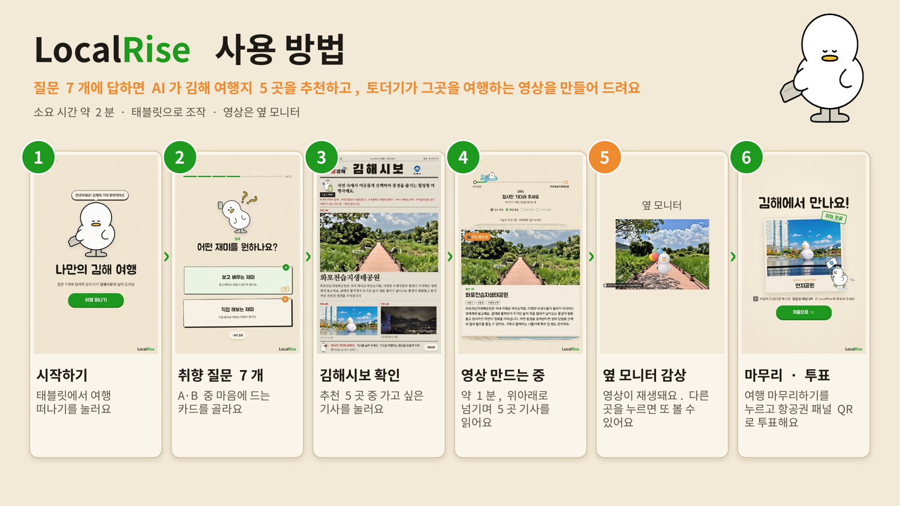
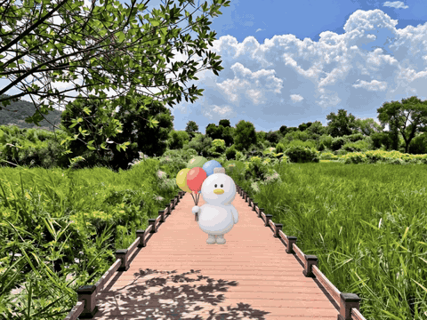
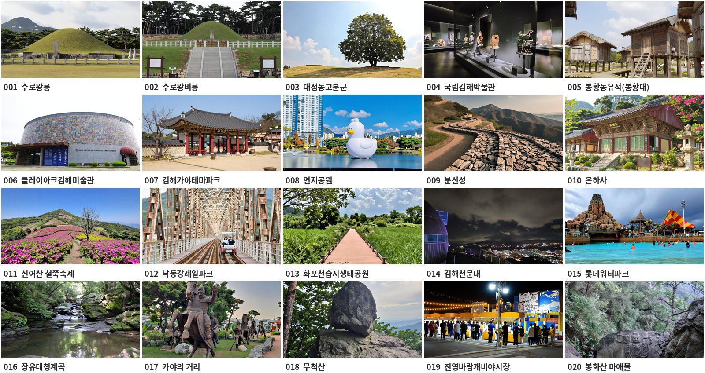

# LocalRise — 2026 AIM Challenge 本選 🏆 優秀賞

> **「흩어진 데이터를 모아, 당신만의 여행을 완성하다」**<br>
> 散らばったデータを集めて、あなただけの旅を完成させる

**質問7つに答えるとAIが金海（キメ）の観光地を5か所おすすめし、ガイドキャラクターがそこを旅する映像をその場で生成するサービス**<br>
질문 7개에 답하면 AI가 김해 관광지 5곳을 추천하고, 가이드 캐릭터가 그곳을 여행하는 영상을 현장에서 만들어 주는 서비스

| 大会 / 대회 | 結果 / 결과 | 展示 / 전시 |
|---|---|---|
| 2026 AIM Challenge（担当地域: 金海市 / 김해시） | 本選進出 9チーム・**優秀賞** / 본선 9팀 진출 · **우수상** | CO-SHOW 2026（2026.11.18〜20）でタブレット＋モニターによる現場デモ |



<p align="center">
  <br>
  <sub>生成された映像の例（화포천습지생태공원）/ 실제 생성 영상 예시</sub>
</p>

---

## 🎯 デモの流れ / 시연 흐름

```
① タブレットで2択の質問7つに答える（MBTI診断のような形式）
        ↓
② AIエージェント（OpenAI）が回答から金海の観光地5か所を推薦
        ↓
③ 「金海市報（新聞）」コンセプトの画面で推薦結果を表示
        ↓
④ Comfy Cloud で映像を約1分でリアルタイム生成 → 隣のモニターで再生
```

① 2지선다 성향 질문 7개 → ② AI 에이전트가 김해 관광지 5곳 추천 → ③ '김해시보' 신문 컨셉 화면으로 결과 표시 → ④ Comfy Cloud로 약 1분 안에 영상 실시간 생성, 옆 모니터에서 재생

---

## 🖼 LoRAで生成した金海の観光地20か所 / LoRA로 생성한 김해 관광지 20곳

観光地ごとにLoRAを学習（ai-toolkit）し、ComfyUIで生成した画像です。<br>
장소마다 LoRA를 학습(ai-toolkit)하고 ComfyUI로 생성한 이미지입니다.



---

## 🛠 Tech Stack

| 分野 / 분야 | 技術 / 기술 |
|---|---|
| 推薦 API / 추천 API | Python, FastAPI, pandas, OpenAI API (gpt-4o-mini) |
| 画像・映像生成 / 이미지·영상 생성 | ComfyUI, Comfy Cloud API |
| モデル学習 / 모델 학습 | LoRA (ai-toolkit) — 観光地20か所 / 장소 20곳 |
| デモ画面 / 시연 화면 | HTML, CSS, JavaScript（キオスク画面＋モニター画面 / 키오스크 + 모니터 화면） |
| 協業 / 협업 | Git, GitHub（Issue・PR・ブランチ運用）, Slack |

---

## 💡 工夫したところ / 신경 쓴 부분

- **60秒以内のリアルタイム生成**: 映像生成を Comfy Cloud に任せ、生成中は5か所の記事を読める待機画面にして、待ち時間も体験の一部にした<br>
  **60초 이내 실시간 생성**: 영상 생성을 Comfy Cloud로 돌리고, 생성되는 동안 5곳 기사를 읽는 대기 화면으로 기다리는 시간도 체험의 일부로 만듦
- **毎回ちがう映像**: リクエストごとにシードを変えて生成<br>
  **관람객마다 다른 영상**: 요청마다 시드를 새로 뽑아 생성
- **推薦の品質チェック**: 回答の全128通りを事前に生成し、推薦の偏りを検証（異なる組み合わせ 100/128、全20か所が1回以上推薦）→ [レポート](docs/recommend_quality_report.txt)<br>
  **추천 품질 점검**: 답변 조합 128가지를 미리 생성해 추천이 한쪽으로 쏠리지 않는지 검증
- **展示の安定性**: 推薦結果をキャッシュし、現場のネットワークが不安定でもすぐ応答<br>
  **전시 안정성**: 추천 결과를 캐시해 현장 네트워크가 불안정해도 바로 응답

---

## 👥 チーム / 팀

| 名前 / 이름 | 担当 / 역할 |
|---|---|
| 최완석 チェ・ワンソク（リーダー / 팀장） | 全体パイプライン管理、推薦 API・キオスク画面・Comfy Cloud リアルタイム映像生成の実装、観光地20か所の LoRA 学習・画像生成、提出資料管理、GitHub 運用・スケジュール管理<br>전체 파이프라인 관리, 추천 API·키오스크 화면·Comfy Cloud 실시간 영상 생성 구현, 장소 20곳 LoRA 학습·이미지 생성, 제출 자료 관리, GitHub 운영·일정 관리 |
| 강민호 | フロントエンド、ComfyUI 映像制作 / 프론트엔드, ComfyUI 영상 제작 |
| 이민영 | アイデア提案、バックエンド（API）の土台 / 아이디어 제시, 백엔드 틀(API) 마련 |
| 오정근 | 会議録の作成・整理 / 팀 회의록 작성·정리 |

各メンバーのコミット履歴 / 커밋 기록: [Contributors](https://github.com/acesnack4950/localrise/graphs/contributors)

---

## 📂 構成 / 폴더 구조

```
localrise/
├─ agent/                    # 推薦 API サーバー / 추천 API 서버
│  ├─ app.py                 #   FastAPI（質問・推薦・観光地情報）
│  ├─ video_jobs.py          #   Comfy Cloud 映像生成ジョブ / 영상 생성 작업
│  ├─ gimhae_places.csv      #   金海の観光地20か所 / 김해 관광지 20곳 데이터
│  ├─ quiz.json              #   2択の質問7つ / 2지선다 질문 7개
│  ├─ workflows/             #   観光地ごとの ComfyUI ワークフロー / 장소별 워크플로
│  └─ static/
│     ├─ kiosk/              #   タブレット画面・モニター画面 / 태블릿·모니터 화면
│     └─ images/             #   LoRA 生成画像 / LoRA 생성 이미지
├─ submission/               # 本選提出資料 / 본선 제출 자료
├─ docs/                     # README 画像・推薦品質レポート
├─ .env.example              # 環境変数の例（本物のキーは入れない）
└─ CONTRIBUTING.md           # チームの作業ルール / 팀 작업 규칙
```

---

## ▶️ 実行方法 / 실행 방법

```bash
cd agent
pip install -r requirements.txt
cp ../.env.example .env      # OPENAI_API_KEY, COMFY_API_KEY を入力 / 값 입력
python app.py                # http://localhost:5000
```

- キオスク画面 / 키오스크 화면: `http://localhost:5000/static/kiosk/index.html`
- モニター画面 / 모니터 화면: `http://localhost:5000/static/kiosk/display.html`

> LoRA モデル（`.safetensors`）・生成映像・`.env` は容量とセキュリティのため含めていません。<br>
> LoRA 모델, 생성 영상, `.env`는 용량·보안 때문에 올리지 않았습니다.

---

## ©️ クレジット / 출처

- ガイドキャラクター「토더기（トドギ）」© 金海市 — 金海市の使用許可を得てデモに使用。キャラクター画像ファイルはリポジトリに含めていません。<br>
  가이드 캐릭터 '토더기' © 김해시 — 김해시의 사용 허락을 받아 시연에 사용했습니다. 캐릭터 이미지 파일은 저장소에 넣지 않았습니다.
- フォント / 폰트: SIL Open Font License（`agent/static/kiosk/fonts/` にライセンス同梱）
